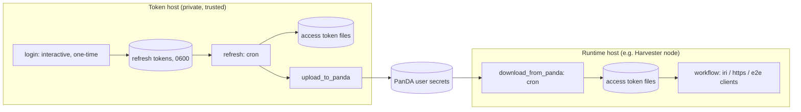
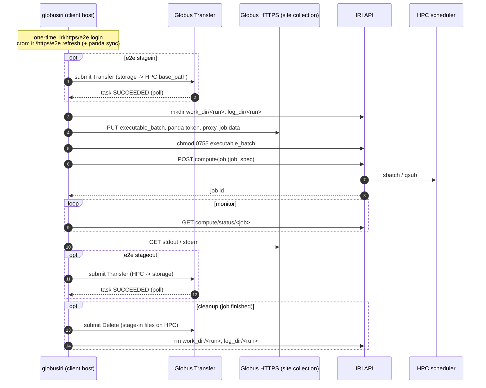

# GlobusIRI — Design

Status: draft, written before implementation.

GlobusIRI is a standalone Python package and CLI (`globusiri`) for running batch jobs on
DOE HPC facilities through the **IRI API**, with files moved through **Globus**:

- **IRI** submits, monitors, and cancels batch jobs, and runs filesystem operations
  (`mkdir`, `chmod`, `ls`, `stat`, `rm`).
- **Globus HTTPS** moves small files between the client host and the HPC: run scripts and
  credentials go up, stdout/stderr come back.
- **Globus E2E** (endpoint-to-endpoint Transfer) moves bulk data between a storage endpoint
  (for example, BNL dCache) and the HPC filesystem: input datasets go in, outputs come out.

The package pulls together logic that is currently spread across several places:

| Existing code | What it does today | Becomes |
|---|---|---|
| `harvester/pandaharvester/harvestermisc/iri_utils.py` | `IriClient` and `GlobusClient` (HTTPS) | `globusiri.clients.iri`, `globusiri.clients.https` |
| `harvester/.../harvestersubmitter/iri_submitter.py` | Builds the job spec, uploads inputs, submits | `globusiri.jobs` (submit), `globusiri.staging.https` |
| `harvester/.../harvestermonitor/iri_monitor.py` | Maps job states, downloads logs | `globusiri.jobs` (status), `globusiri.staging.https` |
| `harvester/.../harvestersweeper/iri_sweeper.py` | Cancels jobs | `globusiri.jobs` (cancel) |
| `harvester/.../go_bulk_preparator_v4.py`, `go_bulk_stager_v4.py` | Globus Transfer stage-in and stage-out | `globusiri.staging.e2e` |
| `harvester/examples/hpc/generate_*_token_to_panda.py`, `get_globus_token.py` | Token login, refresh, and PanDA secret sync | `globusiri.tokens.*` |
| `harvester_HPC/cron.sh` | Hand-edited cron of the scripts above | `globusiri <kind> refresh` driven by one config file |
| `harvester_HPC/panda_queueconfig.json` (IRI queues) | Per-site settings repeated across 5 plugin blocks | One `sites.<name>` block in `<WORK_DIR>/config/sites.yaml` |

GlobusIRI does **not** depend on Harvester. Harvester plugins can later import it and become
thin adapters (see [Harvester integration](#harvester-integration)).

---

## 1. Concepts

**Site.** A named HPC target such as `NERSC_Perlmutter` or `ALCF_CRUX`. Each site defines:

- its IRI facility (`nersc` or `alcf`), API base URL, and compute `resource_id`
- remote working and log directories, with an optional filesystem `resource_id` (ALCF uses a
  separate one for Eagle)
- the job template and resource request
- its Globus HTTPS collection and token files
- its Globus E2E endpoint, base path, and default stage-in source and stage-out destination
- a **path map** for each Globus collection it uses, from HPC filesystem paths to Globus paths
  (see §6)

**Tokens.** There are three **separate, independent** tokens. They come from different
logins, and each one is accepted only by its own service:

| Token | One per | Resource server | Globus scope(s) | Accepted by |
|---|---|---|---|---|
| `iri` | facility (`nersc`, `alcf`) | the facility's IRI API | NERSC: `.../ed3e577d-.../iri_api`; ALCF: `.../6be511f6-.../filesystem` | IRI API only (jobs, filesystem) |
| `https` | site (one HTTPS collection) | the collection itself (`<collection_id>`) | `<collection>/https`, `<collection>/data_access` | that collection's `https_server` only (PUT/GET) |
| `e2e` | deployment | `transfer.api.globus.org` | `transfer.api.globus.org:all[*<ep>/data_access ...]` | Globus Transfer API only (transfer tasks) |

None of these tokens can stand in for another. An E2E Transfer token is rejected by a
collection's `https_server`. An HTTPS token cannot submit a Transfer task. Neither one is
accepted by IRI, and an IRI token is not accepted by Globus. GlobusIRI therefore keeps three
token managers, each with its own files, its own PanDA secret key, and its own client, and the
code never passes one kind of token to another kind of client.

**Why one token cannot serve all three.** Globus Auth issues one access token per *resource
server*, not one per login. When a login requests scopes for several resource servers, the
response holds a separate access token and refresh token for each one. globus-sdk exposes
them as `token_response.by_resource_server[...]`. Our three services have three different
resource servers:

- **IRI.** The facility's IRI resource server. The scope is `.../iri_api` for NERSC and
  `.../filesystem` for ALCF.
- **HTTPS.** The HTTPS collection itself (`<collection_id>`), through the `<collection>/https`
  scope.
- **E2E.** `transfer.api.globus.org`. The `[*<ep>/data_access]` scopes are *dependent*
  scopes. They let the Transfer service act on each endpoint on our behalf, but they never
  give us a token that a collection's `https_server` accepts.

What can be shared is the **login**, not the token. If two kinds use the same Globus client
and the same identity, one consent flow can return both tokens.

- **HTTPS + E2E.** These could share a login, because both use client `165ae151-...`.
  GlobusIRI keeps them as separate logins by default for three reasons:
  - HTTPS needs one login per site, often with a different identity per site (the existing
    script warns about this).
  - Separate refresh tokens can be revoked one at a time.
  - Separate logins match the existing scripts and files.

  A combined `login --kinds https,e2e` can be added later. Even then, it would still write two
  token files.
- **IRI.** IRI cannot share a login with HTTPS or E2E. It uses facility-specific clients:
  `fae5c579-...` for NERSC and `8b84fc2d-...` for ALCF.

The E2E token is the only one shared across sites. A single Transfer token, with dependent
`data_access` scopes for each endpoint, covers every configured endpoint. This is what
`generate_transfer_token_to_panda.py` already does for NERSC, SDCC, and Crux.

Each token has a **refresh token**, which is long-lived, created by an interactive login, and
never leaves the host it was created on. It also has an **access token**, which is short-lived
(about 48 hours), is written to a YAML file that the runtime reads, and can be relayed through
PanDA user secrets.

**Site config vs. job file.** `sites.yaml` describes each site. It holds the IRI endpoint,
remote directories, Globus collections, path maps, and API limits such as
`unsupported_resource_fields`, and it is not edited per job. A **job file**, such as
`perlmutter_example_job.yaml`, describes one kind of submission: the template, resources,
inputs, and staging. Users keep several job files and choose one with `--job` each time they
submit. A site may set `job_defaults`, which every job file overrides.

**Run.** One end-to-end execution of the workflow for one job (see §5). A run has a local
state directory, so each step can be resumed or re-run on its own.

---

## 2. Packaging and local layout

### 2.1 Installation

GlobusIRI is published on PyPI as `globusiri`:

```bash
pip install globusiri            # core: IRI, HTTPS, E2E, CLI
pip install "globusiri[panda]"   # + panda-client, for upload_to_panda / download_from_panda
globusiri init                   # create WORK_DIR, copy the example config and example job files
```

Packaging details:

- `pyproject.toml` with the `src/` layout.
- Console script `globusiri = globusiri.cli:main`.
- Python 3.9 or newer.
- Dependencies: `globus-sdk>=4,<5`, `requests`, `PyYAML`, and `platformdirs`. The optional
  `panda` extra adds `panda-client`.
- The example config (`globusiri/data/sites.example.yaml`), the example job files
  (`globusiri/data/jobs/*_example_job.yaml`), and the batch templates
  (`globusiri/data/templates/*.sh`) ship inside the wheel as package data.
- The package has no install-time paths and no dependency on Harvester.

### 2.2 WORK_DIR

All local state lives under one directory, called WORK_DIR:

1. `$GLOBUSIRI_WORK_DIR`, if it is set.
2. Otherwise, the per-user globusiri data directory,
   `platformdirs.user_data_dir("globusiri")`. That is `~/.local/share/globusiri` on Linux and
   `~/Library/Application Support/globusiri` on macOS.

The fallback is deliberately **not** the installed package directory (`site-packages/globusiri`).
That directory is replaced on every `pip install --upgrade`, which would delete the tokens. It
is also often read-only, for example in a root-owned venv or a shared software area.

```
<WORK_DIR>/
  config/sites.yaml                 # site config (from `globusiri init`); fixed per site
  jobs/*.yaml                       # job files, one per kind of submission (examples from `init`)
  tokens/                           # 0700, never commit or share
    iri/<facility>.refresh.json     #   refresh token (token host only)
    iri/<facility>.access.yaml      #   base_url, resource_id, access_token, expires_at
    https/<SITE>.refresh.yaml       #   client_id, refresh_token, collection_id, https_server
    https/<SITE>.access.yaml        #   client_id, access_token, expires_at, collection_id, https_server
    e2e/refresh.yaml
    e2e/access.yaml                 #   client_id, access_token, expires_at, <label>_https
  logs/globusiri.log                # rotating CLI/library log (tokens redacted)
  runs/index.db                    # SQLite summary index (derived from state.json)
  runs/.index.lock                 # short lock for state/index publication and rebuilds
  runs/.daemon.lock                # at most one daemon for this WORK_DIR
  runs/<run_id>/                    # job.yaml (resolved snapshot), state.json, executable_batch, globusiri.log (this run only), stdout/stderr
  templates/                        # optional user templates; override packaged ones by name
  inputs/                           # optional files uploaded with each job (panda token, ...)
```

Rules:

- **Token locations are fixed by convention**, so the config never lists token paths. An
  advanced user can still override a single file with `token_files:` (see configuration.md).
- **Relative local paths** in the config and job files, such as `inputs` and `template_file`,
  are resolved against WORK_DIR. A `--job NAME` that is not an existing path is looked up in
  `<WORK_DIR>/jobs/`.
- **Templates** are looked up in `<WORK_DIR>/templates/` first, then in the packaged
  `globusiri/data/templates/`.
- **The config file** is found by `--config`, then `$GLOBUSIRI_CONFIG`, then
  `<WORK_DIR>/config/sites.yaml`.
- **Directory creation.** WORK_DIR and its subdirectories are created on first use.
  `tokens/` is created with mode 0700.
- **`globusiri paths`** prints the resolved WORK_DIR, config, token, and log locations, and
  shows which source each one came from.
- **Separate deployments** each set their own `GLOBUSIRI_WORK_DIR`. For example, a token host
  and a runtime host, or two users on one machine.

## 3. Architecture

```
src/globusiri/
  paths.py             # WORK_DIR resolution, conventional token/log/run paths, template lookup
  config.py            # load + validate sites.yaml, ${ENV} expansion, PathMap
  jobfile.py           # load job files, merge job_defaults < job file < --set, snapshot
  validate.py          # per-kind token checks (offline + live), shared by validate/refresh/run
  secure_io.py         # atomic 0600 writes, flat YAML read/write, redaction helpers
  panda_secrets.py     # set/get PanDA user secrets (pandaclient), JSON payloads
  tokens/
    base.py            # TokenManager: login / refresh / upload_to_panda / download_from_panda / status
    iri.py             # facility IRI tokens (NERSC, ALCF client IDs and scopes)
    https.py           # per-collection HTTPS tokens
    e2e.py             # shared Transfer token with data_access for all configured endpoints
  clients/
    iri.py             # IriClient (ported from iri_utils, token redaction fixed)
    https.py           # GlobusHttpsClient: put/get/exists
    transfer.py        # thin wrapper over globus_sdk.TransferClient (globus-sdk v4)
  jobs.py              # JobSpec builder, submit, status (state mapping), cancel, template render
  staging/
    https.py           # stagein (upload) / stageout (download) of small files
    e2e.py             # stagein / stageout Transfer tasks, cleanup delete tasks, wait
  cleanup.py           # IRI rm of run directories, path safety checks
  workflow.py          # run orchestration + persisted run state
  api.py               # GlobusIRI: the Python API, one method per CLI command
  cli.py               # `globusiri` entry point: argument parsing + output over api.py
  data/
    sites.example.yaml
    jobs/perlmutter_example_job.yaml
    jobs/crux_example_job.yaml
    templates/perlmutter_iri_submit_template.sh
    templates/crux_iri_submit_template.sh
```

**One API, two front ends.** `api.GlobusIRI` holds every operation and returns plain data;
it never prints. `cli.py` only parses arguments, calls one `GlobusIRI` method and formats
the result, so the CLI and Python callers (for example Harvester plugins) always behave
the same. See [api.md](api.md).

**globus-sdk v4 only.** v2 and v3 are not supported, and there is no compatibility layer.
The code uses only v4 APIs:

- `TransferData(source_endpoint, destination_endpoint, ...)` without a client argument,
  submitted with `TransferClient.submit_transfer(tdata)`.
- Scopes are built with v4 scope objects: `TransferScopes`, plus per-collection
  `https` / `data_access` scopes attached as dependencies of the Transfer scope. They are not
  built as hand-written scope strings.
- `NativeAppAuthClient` for logins, and `RefreshTokenAuthorizer` / `AccessTokenAuthorizer`
  for clients.

The existing Harvester code (`go_bulk_preparator_v4`, `iri_utils`) supports both v3 and v4.
That dual support is dropped when the code is ported.

### Deployment roles

Tokens are split across two kinds of host so that refresh tokens can stay off the
production machine:



If both roles run on the same host, `refresh` writes the access token file directly and
the PanDA round trip is skipped. This is the current mode in `cron.sh`.

---

## 4. Token management

Every kind exposes the same five operations behind one interface:

```python
class TokenManager:
    def login(self, *, force=False) -> None           # interactive; writes refresh token
    def refresh(self, *, min_lifetime=0) -> Token      # refresh -> access token file
    def upload_to_panda(self) -> None                  # access token file -> PanDA secret
    def download_from_panda(self) -> Token             # PanDA secret -> access token file
    def status(self) -> TokenStatus                    # exists? expires_at? valid?
```

### 4.1 IRI (`globusiri iri ...`)

- **login.** Runs a Globus native-app flow with `openid profile email view_identities` and
  the facility scope. The client ID depends on the facility: NERSC uses `fae5c579-...` and ALCF
  uses `8b84fc2d-...`, matching `get_globus_token.py`. The full token response, including the
  refresh token, is saved to `tokens/iri/<facility>.refresh.json` (mode 0600). This replaces `generate_iri_token_to_panda.py --force-login`.
- **refresh.** Refreshes using the stored refresh token. To be compatible with older token
  files, it tries both known client IDs. It extracts the facility token and writes
  `tokens/iri/<facility>.access.yaml` (`base_url`, `resource_id`, `access_token`, `expires_at`). It then
  optionally validates the token: NERSC calls `GET /api/v1/account/projects` and ALCF calls a
  filesystem `ls` on Home. If no refresh token is usable, it never prompts and exits with code
  `3`, so cron can alert on it.
- **upload_to_panda / download_from_panda.** Send the access token to, or fetch it from,
  `iri.panda_secret_key` (for example, `NERSC_IRI_ACCESS`).

### 4.2 HTTPS (`globusiri https ...`)

- **The HTTPS collection is its own collection.** It is not assumed to be the E2E endpoint.
  For ALCF Crux, the HTTPS collection differs from the E2E endpoint `05d2c76a-...`. The HTTPS
  collection is discovered at login, as `harvester_HPC/hpc/generate_https_token_to_panda.py`
  does today. The discovered `collection_id` and `https_server` are stored in the token files,
  and at runtime they are read from those files, not from the site config.
- **login.** Uses `client_id` `165ae151-...` (USATLAS_HPC_Globus).
  1. A first login with the basic Transfer scope runs `endpoint_search(https.collection_query)`
     and picks result `https.collection_pick`. These defaults match `SITE_QUERIES`: `NERSC DTN`
     at index 0 and `alcf#dtn_eagle` at index 0. The command prints the candidates, the same
     way the existing script does.
  2. If `https.collection_id` is set in the config, it is used and the search is skipped. This
     is an optional pin.
  3. A second login requests `<collection>/https` and `<collection>/data_access` with refresh
     tokens. The command prints the "log in as the identity that has access to <site>"
     warning, then writes `tokens/https/<SITE>.refresh.yaml` with `client_id`, `refresh_token`,
     `collection_id`, and `https_server`.
- **refresh.** Writes `tokens/https/<SITE>.access.yaml` with `client_id`, `access_token`,
  `expires_at`, `collection_id`, and `https_server`. These values are copied from the refresh
  file. This is the existing format, so current Harvester plugins can keep reading it.
- **PanDA sync.** The payload is the JSON of the access token file, which is what the
  existing script already sends.

### 4.3 E2E (`globusiri e2e ...`)

- One Transfer token covers every endpoint in `e2e.endpoints` that has `data_access: true`.
  The scope is
  `transfer.api.globus.org:all[*https://auth.globus.org/scopes/<ep>/data_access *.../https ...]`.
- **Endpoint discovery.** Each endpoint is given either an `id` or a `query`/`pick` (the same
  idea as `ENDPOINT_QUERIES`: `NERSC DTN`, `SDCC`, `alcf#dtn_eagle`). At login, every query is
  resolved and its candidates are printed. If an endpoint has both an `id` and a `query` and
  they resolve to different IDs, login stops with an error, because a token consented for the
  wrong endpoint fails later with `ConsentRequired`.
- **BNL storage endpoint.** Today's token requests `data_access` for the endpoint found by
  `SDCC` (search index 0, with the comment "bump to 1 or 2 if wrong"). The queue config uses
  BNL dCache `12782fb1-...` as the stage-in source and stage-out destination. The example
  config therefore lists BNL with both `id: 12782fb1-...` and `query: SDCC`, so login confirms
  that the `SDCC` search result really is the endpoint the transfers use.
- Files and PanDA key are `tokens/e2e/refresh.yaml`, `tokens/e2e/access.yaml`, and
  `e2e.panda_secret_key` (`USATLAS_HPC_TRANSFER_TOKEN`). The access file format matches what
  `go_bulk_preparator_v4` reads (`client_id`, `access_token`, `expires_at`, `<label>_https`).
- E2E is not per-site. The CLI still accepts a site argument for symmetry and ignores it, with
  a note.

### 4.4 Common rules

- **PanDA payload format.** All three token kinds store their secret as JSON, which is the
  access token file's content. For IRI that is `{"base_url", "resource_id", "access_token",
  "expires_at"}`, so `download_from_panda` can also report and check the expiry time. When
  reading, a value that is not JSON is treated as a bare `access_token`, because that is how
  `*_IRI_ACCESS` is stored today. Existing secrets keep working until the next upload replaces
  them.
- **`refresh --min-lifetime 6h`.** Skips the refresh, with exit code 0, when the current
  access token still has more than that much life left. Cron can then run often without
  extra load on Globus Auth.
- **`refresh --upload-to-panda`.** Combines the two steps for the common cron line.
- **Atomic writes.** All files are written to a temporary file, set to 0600, then renamed
  with `os.replace`. Readers such as Harvester plugins that call `reload()` never see a
  half-written file.
- **No secret output.** Nothing prints or logs a token. The debug `curl` echo in
  `iri_utils.IriClient._curl` currently prints `Authorization: Bearer <token>` to stderr; the
  port replaces it with `<redacted>`.

---

### 4.5 Validation (`globusiri validate`)

`globusiri validate` checks every token for every site in one command (see
[cli.md](cli.md#validate-tokens)). Each token is checked **against its own service**, because
the three tokens are not interchangeable (§1):

- **IRI.** The facility's validation call (NERSC: `account/projects`; ALCF: filesystem `ls` on
  Home), then an IRI `stat` on `remote.work_dir`.
- **HTTPS.** A `GET` of the mapped `remote.work_dir` on the collection's `https_server`.
  `--write-test` adds a `PUT` and `GET` round trip.
- **E2E.** `get_endpoint` and `operation_ls` on every configured endpoint.

Live checks also exercise the site config. A wrong `path_map` shows up as a 404 or "not found"
rather than an auth error, and a missing `data_access` consent shows up as `ConsentRequired`
for a named endpoint. `--panda` detects a PanDA secret that is out of sync with the local
access file.

The checks live in `validate.py` as one function per token kind. Each returns a list of
`Check(site, kind, name, status, detail, fix)` results. `refresh` (when `iri.validate` is set)
and `run` reuse the same functions. `<kind> status` stays an offline-only view.

**Job-aware validation.** Not every job needs all three tokens. `required_kinds(site, job)`
returns:

- `iri`: always.
- `https`: when the site's `remote.upload_method` is `globus_https`, or the job's
  `staging.https_stageout` downloads anything.
- `e2e`: only when the job sets `staging.e2e.enabled: true`.

`validate --job` and the pre-flight check in `run` validate only these kinds, and report the
other kinds as `skipped` with the reason. A job with no E2E transfers therefore runs even when
the E2E token is missing or expired. Because the pre-flight check runs before any transfer or
submission, a bad token fails fast and no HPC allocation is used. With no `--job`, `validate`
checks every kind for every site.

## 5. Workflow



### 5.1 Steps

| # | Step | Command | Details |
|---|---|---|---|
| 0 | One-time login | `globusiri {iri,https,e2e} login SITE` | Interactive, on the token host |
| 1 | Keep tokens fresh | `globusiri {iri,https,e2e} refresh SITE --min-lifetime 6h [--upload-to-panda]` | Cron, every 1–2 hours |
| 1b | Runtime host sync | `globusiri {iri,https,e2e} download_from_panda SITE` | Cron, only when roles are split |
| 2 | E2E stage-in (optional) | `globusiri e2e stagein SITE --manifest in.txt` | Transfer task; waits until done unless `--no-wait` |
| 3 | Prepare remote dirs | part of `job submit` | IRI `mkdir -p` for `work_dir/<run>` and `log_dir/<run>` |
| 4 | HTTPS upload | `globusiri https stagein SITE LOCAL... --to REMOTE_DIR` | Rendered batch script and credentials |
| 5 | Make executable | part of `job submit` | IRI `chmod 0755`, because HTTPS PUT does not keep the file mode |
| 6 | Submit | `globusiri job submit --job JOB_FILE` | Builds `job_spec` (§5.2) and records the job id |
| 7 | Monitor | `globusiri job status SITE JOBID [--wait]` | State mapping in §5.3 |
| 8 | HTTPS download | `globusiri https stageout SITE REMOTE... --to LOCAL_DIR` | stdout/stderr paths come from the job's `admincomment` when present, otherwise from `log_dir/<run>/` |
| 9 | E2E stage-out (optional) | `globusiri e2e stageout SITE --manifest out.txt` | Transfer task |
| 10 | Cleanup (optional) | `globusiri e2e cleanup SITE --manifest in.txt`, `globusiri job cleanup SITE RUN_ID` | Globus delete task for the stage-in files on the HPC, then IRI `rm` of `work_dir/<run>` and `log_dir/<run>` |

`globusiri run --job JOB_FILE` first validates the tokens the job requires (§4.5), then runs
steps 2–10 in order. Steps 2 and 9 (the E2E transfers) run only when the job sets
`staging.e2e.enabled: true`. Otherwise they are recorded as `skipped`. Step 10 runs only when
the job file's `cleanup` section enables it, the job finished successfully, and steps 8 and 9
did not fail. Otherwise it is recorded as `skipped` and the files are kept for debugging. Each step is also its own command, so
Harvester or a user can drive the steps individually.

### 5.1a Execution modes

The workflow engine (`workflow.advance`) never blocks. One pass over a run checks the current
step (a Globus task status or the IRI job state). If that step is done, the pass starts the
next one, and it stops at the first step that is still in progress. The same engine runs in
three modes:

| Mode | Entry point | Who calls `advance` |
|---|---|---|
| Plugin | `g.submit()` once, then `g.monitor()` / `globusiri monitor` | the host program (e.g. Harvester's monitor cycle), each time it wants progress |
| Daemon | `globusiri submit`, then `globusiri daemon` (or `g.daemon()`) | the daemon, every `--interval` seconds |
| Blocking | `globusiri run` / `g.run()` | `run`, in a loop until the run ends |

A run's `status` is `active`, `finished`, `failed`, or `cancelled`. `monitor()` picks up only
`active` runs. A step error that cannot be fixed by retrying (failed transfer, failed
validation, config error) fails the run. Any other error is recorded as `last_error`, and the
step is retried on the next pass, up to `max_attempts` passes in a row. A per-run `flock` on
`runs/<run_id>/.lock` lets several callers share a WORK_DIR (a daemon, a plugin, the CLI)
without running the same step twice. One more caveat: a `submit` step that fails with a
transient error after IRI already accepted the job (a lost response) is retried, and that
retry can submit the job twice.

### 5.2 Job spec

The job spec is built from the resolved job (site `job_defaults`, then the job file, then
`--set`) together with the site config, which supplies the directories and API limits. Its
layout matches `IriSubmitter.submit_workers` exactly, so behavior stays the same at both
facilities:

- `executable = <work_dir>/<run>/executable_batch`, `directory = <work_dir>/<run>`,
  `stdout_path` and `stderr_path` under `<log_dir>/<run>/`, `inherit_environment: true`
- `resources`: `node_count`, `process_count`, `processes_per_node`, `cpu_cores_per_process`,
  `exclusive_node_use`, optional `memory` and `gpu_cores_per_process`. Any field listed in
  the site's `unsupported_resource_fields` is dropped. ALCF's PBS backend returns 501 for
  `process_count`, `processes_per_node`, and `cpu_cores_per_process`.
- `attributes`: `duration`, `queue_name`, `account`, `reservation_id`, and
  `custom_attributes`. The custom attributes merge `constraint`, `signal`, `no_requeue`,
  `licenses`, `export`, `image`, and `volume` with `resources.custom_attributes` from the job (for example,
  ALCF's `filesystems: home:eagle`, `place: scatter`).
- `launcher`: one of `null`, `single`, `mpirun`, `srun`, `aprun`, or `jsrun`.

Templates are rendered with `str.format_map` and a `SafeDict`, using the same placeholder names
as Harvester (`{work_dir}`, `{stdout_path}`, `{nNode}`, `{pandaTokenFilename}`, ...). This
lets the existing `perlmutter_iri_submit_template.sh` and `crux_iri_submit_template.sh` work
without changes.

### 5.3 State mapping

| IRI `status.state` | GlobusIRI state | Harvester equivalent |
|---|---|---|
| `new`, `queued` | `submitted` | `ST_submitted` |
| `active` | `running` | `ST_running` |
| `completed` with `exit_code` of 0 or null | `finished` | `ST_finished` |
| `completed` with a non-zero `exit_code` | `failed` | `ST_failed` |
| `canceled` | `cancelled` | `ST_cancelled` |
| anything else, including `failed` | `failed` | `ST_failed` |

`finished`, `failed`, and `cancelled` are terminal. Logs are downloaded once the job reaches
any terminal state.

### 5.4 Run state

Every run (`globusiri run` or `submit`, or `job submit` given `--run-id`) keeps
`<WORK_DIR>/runs/<run_id>/state.json`, next to `job.yaml`, the resolved job snapshot that
every later pass and `--resume` reuse:

```json
{
  "run_id": "20261105-a1b2c3", "site": "NERSC_Perlmutter",
  "status": "active", "current_step": "monitor",
  "options": {"validate": true, "max_attempts": 5},
  "last_error": {"step": "monitor", "error": "RemoteError: 502", "attempt": 1, "at": "…"},
  "remote_work_dir": "/global/cfs/cdirs/m2616/harvester_workdir/20261105-a1b2c3",
  "steps": {
    "e2e_stagein":  {"status": "done", "task_id": "…"},
    "https_stagein": {"status": "done", "files": ["executable_batch", "…"]},
    "submit":       {"status": "done", "job_id": "…"},
    "monitor":      {"status": "running", "state": "queued", "checked_at": "…"},
    "https_stageout": {"status": "pending"},
    "e2e_stageout": {"status": "pending"},
    "cleanup":      {"status": "pending"}
  }
}
```

Re-running `globusiri run --resume <run_id>` skips steps already marked `done` and retries
failed ones. Runs made by `job submit` have no `status` and are not driven by `monitor`. A run can
survive a client restart because the job itself lives on the HPC.

### 5.5 Central index and concurrent processes

`runs/index.db` holds a summary row per run: run ID, site, status, current step, job ID,
timestamps, and last error. `RunState.save()` writes the full state with atomic file
replacement and upserts the summary in a SQLite transaction, under `runs/.index.lock`.
The lock is held only for local bookkeeping; it never covers remote API requests.
Initialization and rebuilds use the same lock, so a rebuild cannot overwrite newer state.
Competing creations of the same run ID are serialized by the per-run lock.

`monitor()` queries active rows, oldest first, and reads only those states. Normal queries
never scan run directories. A missing index triggers a one-time import of
`runs/*/state.json`; `globusiri runs --reindex` rebuilds it explicitly. The table printed by
`runs` uses only index rows; JSON and full API results load the selected states.

SQLite uses WAL and WORK_DIR must be on a local filesystem with reliable POSIX locks.
Concurrent submitters, monitor callers, and reindexing can share it. A process killed
between replacing JSON and committing the database can leave a stale index; rebuild from
the authoritative JSON to recover. This does not provide exactly-once remote submission:
a lost IRI response after acceptance can still cause a duplicate submission on retry.

---

## 6. Path mapping

The path of a directory inside a Globus collection can differ from the path where that same
directory is mounted on the HPC. IRI, the batch script, and the job's stdout/stderr paths all
use the **HPC mount path**. Globus HTTPS and Transfer use the **collection path**.

- **NERSC.** Both paths are the same. For example,
  `/global/cfs/cdirs/m2616/harvester_workdir` is identical in both, so no map is needed.
- **ALCF.** The mount path `/lus/eagle/projects/ATLAS_workflow_ALCF/...` appears in Globus as
  `/ATLAS_workflow_ALCF/...`, so a map is needed.

Today this is handled with three separate settings (`globus_upload_dir`,
`globus_download_dir`, and the Globus-relative preparator `basePath`) plus a substring strip
(`_strip_globus_prefix`). GlobusIRI replaces these with a `path_map` on **each Globus
collection**, not one per site. ALCF's HTTPS collection and its E2E endpoint are different
collections, and their roots do not have to match.

```yaml
sites:
  ALCF_CRUX:
    https:
      path_map: {/lus/eagle/projects: /}     # HTTPS collection
e2e:
  endpoints:
    Crux:
      id: 05d2c76a-e867-4f67-aa57-76edeb0beda0
      path_map: {/lus/eagle/projects: /}     # E2E endpoint
```

- `PathMap.to_globus(hpc_path)` and `PathMap.to_hpc(globus_path)` use the longest matching
  prefix. A path with no matching prefix passes through unchanged, so an empty or missing map
  means the paths are identical (NERSC).
- Every path in the config is written as an **HPC mount path**: `remote.work_dir`,
  `remote.log_dir`, and `e2e.base_path`. Each path is converted only where it crosses into
  Globus, using the map of the collection being accessed.
- Paths reported by IRI, such as `stdoutPath` from `admincomment`, are HPC paths and go
  through `to_globus` before an HTTPS download. This replaces `_strip_globus_prefix`.
- The storage-side paths in a Transfer (`stagein.src_path` and `stageout.dst_path` on BNL)
  are already Globus paths and are never mapped.

---

## 7. E2E staging details

- **Inputs.** A manifest has one line per file, in the form `src_path dst_path`. A
  `--rucio SCOPE:NAME` shortcut expands a file to Rucio's deterministic path
  (`<scope>/<md5[0:2]>/<md5[2:4]>/<name>`) under the site's `stagein.src_path` and
  `e2e.base_path`, which matches `mover_utils.construct_file_path`.
- **Submission.** One `TransferData` per batch, with at most `e2e.max_files_per_task` items
  (default 1000). Options are `sync_level` (default `exists`, which avoids re-copying files
  already present) and `verify_checksum` (default true). The label is
  `globusiri-<run>-IN` or `-OUT`.
- **Waiting.** Polls `get_task` every `poll_interval` seconds until `SUCCEEDED` or `FAILED`,
  or until `timeout`. On failure it reports the failed files from
  `task_successful_transfers` and `task_skipped_errors`.
- **Consent errors.** When an endpoint requires a `data_access` consent the token lacks,
  Globus returns `ConsentRequired`. This is reported with the exact fix,
  `globusiri e2e login --force`, and never retried in a loop.
- **Token reload.** When the access token file's mtime changes, the client is rebuilt. This
  is the same pattern as `refresh_transfer_client`.
- **Cleanup.** `e2e cleanup` removes stage-in files from the HPC with a `DeleteData` task on
  the site's HPC endpoint (not recursive, `ignore_missing`, batched like transfers, label
  `globusiri-<run>-CLEANUP`). The files come from the stage-in manifest's `DST` column, from
  Rucio paths under `e2e.base_path`, or from explicit paths. Each path must be below
  `remote.work_dir`, `remote.log_dir` or `e2e.base_path` unless `--force` is given. Remote run
  directories are removed separately with IRI `rm` (`job cleanup`). Deleting a file through
  the E2E endpoint is more efficient than many IRI calls, and it reuses the token that wrote
  the file.

## 8. HTTPS staging details

- `PUT {https_server}/{to_globus(path)}` with `Authorization: Bearer <https token>`, streamed
  from disk. `GET` streams to a temporary file, then renames it.
- GCS HTTPS does not reliably create parent directories, so `stagein` first runs IRI
  `mkdir -p` on the target directory. This matches the submitter's current order.
- File mode is not preserved, so callers that upload an executable must chmod it through IRI
  afterward. `job submit` does this.
- `stageout --skip-existing` (the default for log downloads) skips files that already exist
  locally, as the monitor does today.
- A per-site `upload_method: iri | globus_https` keeps IRI's own upload endpoint available as
  a fallback. The default is `globus_https`.

---

## 9. Errors and exit codes

| Code | Meaning |
|---|---|
| 0 | Success, or `refresh` skipped because the token is still fresh |
| 1 | Generic or unexpected error |
| 2 | Configuration error: unknown site, missing field, unreadable file |
| 3 | Login required: no usable refresh token, or consent missing |
| 4 | PanDA secret error: pandaclient missing, set or get failed, empty secret |
| 5 | Remote API error: IRI or Globus HTTP 4xx/5xx after retries |
| 6 | Job or transfer ended in a failed or cancelled state |
| 7 | Token validation failed (`validate`, or `refresh` with validation) |

Retries: IRI and HTTPS calls retry 3 times with exponential backoff, but only on connection
errors and HTTP 429/5xx. A 4xx is never retried. IRI async filesystem tasks keep the existing
`task_id` polling (5 seconds × 60).

## 10. Security

- Refresh tokens are kept only on the token host, in files with mode 0600 in a directory with
  mode 0700. They are never sent to PanDA or the HPC.
- Access tokens are short-lived. They are written with mode 0600 and redacted in all logs and
  debug output.
- The HPC receives only what the job needs: the batch script, the PanDA token and key, the
  X.509 proxy, and job data. Globus tokens are never uploaded.
- `sites.yaml` never contains token values. Tokens live only in `<WORK_DIR>/tokens/`, which
  has mode 0700. `globusiri init` refuses to use a WORK_DIR inside a git work tree unless
  `--force` is given, and the repository `.gitignore` excludes `tokens/`.

## 11. Harvester integration

GlobusIRI does not ship Harvester plugins. Instead, the API works in plugin mode (§5.1a):
a plugin calls `g.submit(...)` once per worker, using `run_id` as the worker's `batchID`, then
calls `g.monitor([run_ids])` in each `check_workers` cycle and maps `plugin_status` to
`WorkSpec.ST_*` (the strings are the same). It calls `g.cancel(run_id)` in `kill_worker`.
Each `monitor` call moves the workflow on by itself, so no cron job and no daemon is needed.

Alternatively, the plugins can drive single steps (`g.run_state()` then only reads progress
when a `globusiri daemon` advances the runs):

- `IriSubmitter.submit_workers` calls `g.job_submit(job_file, site, set=..., inputs=...)`
- `IriMonitor.check_workers` calls `g.job_status` and `g.https_stageout_job_logs`
- `IriSweeper.kill_worker` calls `g.job_cancel`, and `IriSweeper.sweep_worker` calls `g.job_cleanup`
- `GlobusBulkPreparator` and `GlobusBulkStager` call `g.e2e_stagein` / `g.e2e_stageout` with
  `wait=False`, then `g.e2e_task` to check the tasks

Harvester installs `globusiri` from PyPI into its venv and sets `GLOBUSIRI_WORK_DIR` in its
environment. The queue config then needs only `"globusiri_site": "NERSC_Perlmutter"`, and all
site details live in one place. This step is out of scope for the first implementation.

## 12. Implementation order

All six steps are implemented in v0.1.0, with unit tests in `tests/` that run without network access. They have not yet been tested against the live NERSC and ALCF services.

1. `pyproject.toml`, `paths.py`, `config.py`, `secure_io.py`, `globusiri init` and `globusiri paths`, plus unit tests for WORK_DIR resolution, config loading, and path mapping
2. Token managers, the `iri`, `https`, and `e2e` login/refresh/panda/status CLI, and `globusiri validate`, replacing `cron.sh`
3. `clients/iri.py` (port) and `jobs.py`: `job submit`, `job status`, `job cancel`
4. `staging/https.py`: `https stagein` and `https stageout`
5. `staging/e2e.py`: `e2e stagein` and `e2e stageout`
6. `workflow.py`: `run` and `--resume`

## 13. Open questions

Resolved:

- **HTTPS collection ≠ E2E endpoint.** The HTTPS collection is discovered at login and read
  from the token file (§4.2).
- **Path maps are per collection.** NERSC needs none; ALCF needs one (§6).
- **IRI PanDA secret moves to JSON**, and reading stays backward compatible (§4.4).
- **Three independent tokens**, none of them interchangeable (§1).
- **CLI name is `globusiri`.** The commands were first requested as `globus iri login`, but
  `globus` is already the official Globus CLI (`globus-cli`) and would be shadowed. All
  commands use `globusiri`, for example `globusiri iri login ...`.
- **Cleanup.** NERSC and ALCF both expose IRI `DELETE filesystem/rm`. `globusiri job cleanup`
  and `fs rm` use it for remote run directories. `globusiri e2e cleanup` removes stage-in files
  with a Globus delete task. `run` does both at the end when the job file's `cleanup` section
  enables them (§5.1, §7).

Still open:

1. **BNL storage endpoint.** Does the `SDCC` search result (index 0) resolve to BNL dCache
   `12782fb1-...`, the stage-in source and stage-out destination of both IRI queues in
   `panda_queueconfig.json`? This cannot be checked offline. The first `globusiri e2e login`
   prints the search candidates and fails if the result differs from the configured `id`
   (§4.3). If it fails, change `e2e.endpoints.BNL_dCache.pick` and record the right index here.
2. **IRI `rm` on directories.** The IRI API spec describes `filesystem/rm` only as "delete file
   or directory". It does not say whether a non-empty directory is removed recursively.
   `job cleanup` depends on this. Try it once on a finished run at NERSC and at ALCF. If a
   facility refuses non-empty directories, remove the run directory with a recursive Globus
   delete task instead.
3. **Who owns the shared Rucio files.** `--rucio` stage-in writes to deterministic paths under
   `e2e.base_path`, so several jobs on a site can share one file. Deleting it with
   `e2e cleanup` or `cleanup.e2e_stagein` can break another job that is still reading it.
   Options: keep `e2e.base_path` as a long-lived cache with a separate age-based cleanup, make
   cleanup skip Rucio paths, or stage in per run below `remote.work_dir/<run>`. Until this is
   decided, `cleanup.e2e_stagein` is off by default.
4. **Real Rucio support.** `--rucio` only builds the deterministic RSE path (§7). It does not
   look up replicas, expand datasets, or register outputs after stage-out. Is that enough for
   the intended use, or should GlobusIRI use the Rucio client? If it should, that adds a fourth
   credential (Rucio account or token) on the client host.
5. **`remote_export_path` for Crux in Harvester.** In `harvester_HPC/panda_queueconfig.json`,
   `ALCF_Crux_IRI.monitor.remote_export_path` is still `https://portal.nersc.gov/cfs/m2616/`
   (checked 2026-11-05). It is unused because `download_logs_method` is `globus_https`, and
   GlobusIRI does not read it. It looks like a copy-paste mistake. Remove it or point it at
   ALCF in the Harvester config.
